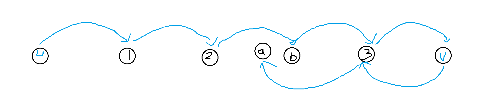
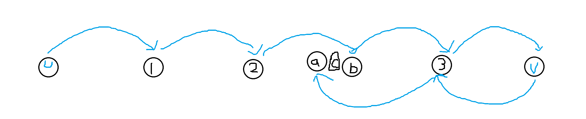
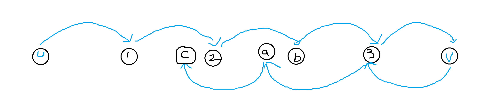
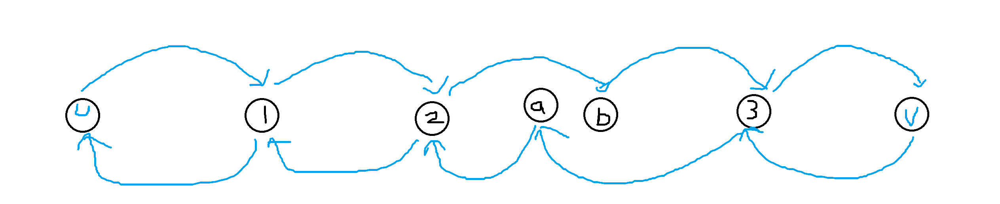
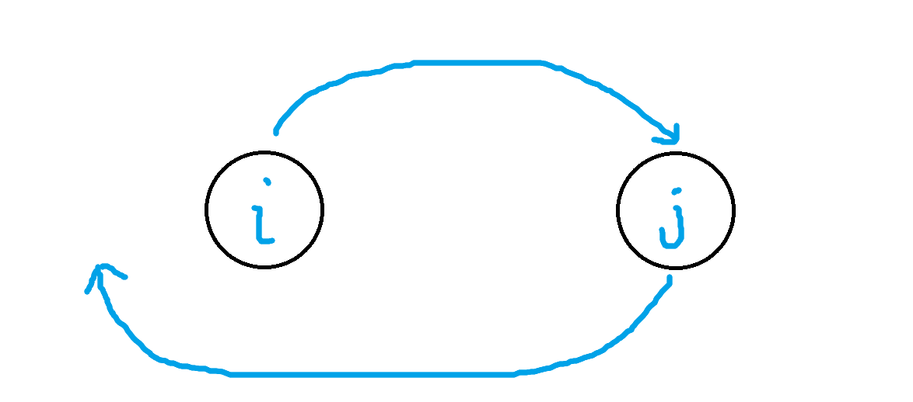
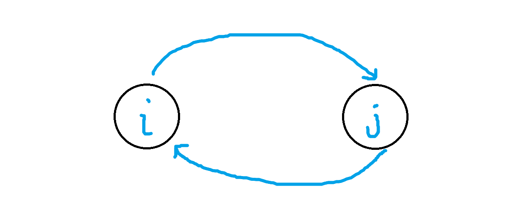
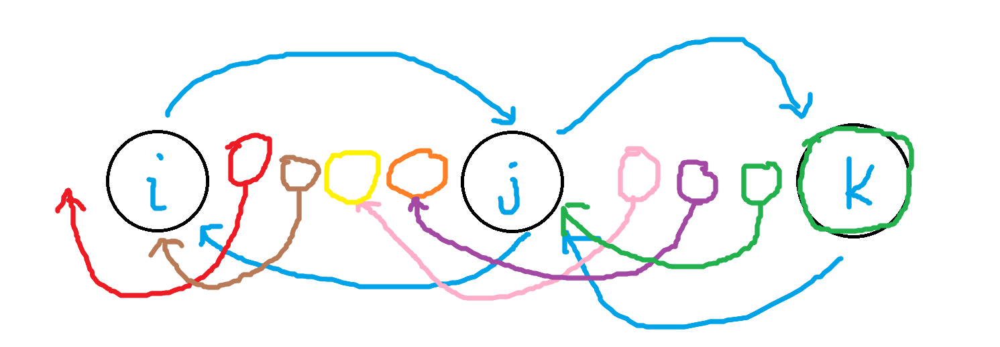

详细讲解 dp 做法，有配图，更易理解。

## 思路

用 $nex_i$ 表示点 $i$ 向右走不超过 $d$ 的距离，可达的最右边的一个位置，$pre_i$ 则表示点 $i$ 向左走不超过 $d$ 的距离，可达的最左边的一个位置，这个可以用双指针扫两次求得。

钦定 $u<v$，从 $u$ 走到 $v$，一种最短路径很显然是每次走到 $nex_u$，直至到达终点。不难发现这种移动方式，只有最后一次移动可能不是 $u \rightarrow nex_u$，因为 $v$ 可能在 $nex_u$ 之前出现。

既然可以正着走，那么也可以反着走，从 $v$ 走到 $u$，每次走到 $pre_v$，直至到达 $u$。同理，只有最后一次移动可能不是 $v \rightarrow pre_v$，因为 $u$ 可能在 $pre_v$ 之后出现。

两种路径的点集如果相同，不难发现只有一种最短路径，不符合题目要求，所以我们尝试将其中一个点集进行微调，寻找恰好两条最短路的路径特征。假设从 $v$ 到 $u$ 的路径上，出现一处 $pre_{nex_b} \neq b$，形如：



不难证明 $a = pre_{nex_b} < b$，即 $a$ 必定在 $b$ 的左侧，那么我们除了上方蓝色的路径之外，会存在另外一条可行路径，即 $u \rightarrow 1 \rightarrow 2 \rightarrow a \rightarrow b \rightarrow 3 \rightarrow v$。

那如果 $a$ 再往左移动一下呢？



这时候可行的路径就不止 $2$ 条了，多了一个 $c$ 点，则从 $2$ 走到 $3$ 有 $3$ 种路径，因此不符合题目要求。

那如果多个位置出现偏移呢？



每次偏移都会产生 $2$ 种走法，那么相乘肯定不止 $2$ 种，也是不符合题目条件的。

所以对于 $u,v$，路径 $u \rightarrow v$ 以及 $v \rightarrow u$ 应该如下图所示：



也就是说，$v \rightarrow u$ 的路径上，恰好有一个点与 $u \rightarrow v$ 的路径的点产生 $1$ 的位置差。

那么问题就转化成，求满足上述条件的 $(u,v)$ 数量。

考虑 dp，从右向左求解。令 $f_{i,0}$ 表示从 $i$ 点出发，两种路径点集相同的终点的个数（即最短路唯一），令 $f_{i,1}$ 表示从 $i$ 点出发，两种路径点集产生了一次偏差的终点个数（即最短路恰好两种）。然后考虑状态转移，以及答案统计。

如果 $nex_i=i$，即 $i$ 点没法往右走了，则 $i$ 只有唯一一个终点，即 $i$ 本身，则有 $f_{i,0}=1, f_{i,1}=0$。

如果 $nex_i = j, pre_j < i$，则 $f_{i,0}=1, f_{i,1}=0$，这里认为路径错位还没有形成，路径错位要留到下一种情况处理。



接着是最麻烦的一种情况，$nex_i = j, pre_j = i$，如图：



显然可以先 $f_{i,0} \leftarrow f_{j,0}, f_{i,1} \leftarrow f_{j,1}$，但是答案远不止这些，我们让这张图更丰富一些：



蓝色的线条表示 $nex$ 和 $pre$，绿色点 $pre = j$，紫色点 $pre = j-1$，粉色点 $pre \le j-2$，棕色点表示 $pre = i$，红色点表示 $pre < i$。

记最左边的一个棕色点为 $p$，则 $f_{i,0} \leftarrow f_{i,0} + (j-p) + 1$，也就是说，$i$ 作为起点，从最左边的点一直到 $j$ 这个区间的点作为终点，最短路数量都是 $1$，但是 $j$ 节点作为终点在 $f_{j,0}$ 被统计过了，要减去，然后还要加上 $i$ 本身，即 $(j-p+1)-1+1$。$p$ 可以在处理出 $nex,pre$ 之后线性预处理。

对于 $i$，记满足 $pre_j = i, j \neq i$ 的 $j$ 的取值有 $tot_i$ 种，这个也可以线性预处理，有了这个东西之后，我们来考虑 $f_{i,1}$ 还缺什么。

$i$ 为起点，紫色点为终点，此时会形成路径错位，但是还必须满足橙色点属于棕色点，即橙色点的 $pre$ 为 $i$，即 $pre_{j-1}=i$，那么，$f_{i,1} \leftarrow f_{i,1} + tot_{j-1}$。还有一种特殊情况，如果 $k$ 本身就是紫色点，即 $pre_k = j-1$，则 $f_{i,1} \leftarrow f_{i,1} + f_{k,0}-1$，感性理解就是 $k$ 后面接了若干个点且最短路都是唯一的，那么算上此处的路径错位，最短路就是恰好两种。

注意，当且仅当 $i \neq j-1$ 的时候才能考虑紫色点，同理，当且仅当 $j \neq k$ 的时候才能考虑跟 $k$ 相关的所有东西。

到这里，我们已经将状态转移全部理清楚了，接下来考虑答案统计。

还是以上面那张一堆颜色的图为例，$i$ 为起点，最短路恰好两条的方案数有哪些。首先，上面转移 $f_{i,1}$ 的量全都可以原封不动地加入 $ans$，所以 $ans \leftarrow ans + tot_{j-1}$，如果 $k$ 满足紫色点，则 $ans \leftarrow ans + f_{k,0}-1$。到这里，还是会发现有一些样例过不去，回到更前面的情况：


刚刚也已经提到，$i$ 这个位置路径错位尚未生成完毕，只有起点再往前看，这里才算路径错位，如果 $i$ 作为起点，这里是不算路径错位的，所以对于这种情况，上面累积的量同样可以累计到 $ans$，只不过不能累计到 $f_{i,1}$。

## 代码

把上面的完整思路理清楚之后，随便写写代码就行了：

```cpp
#define _rep(i,a,b) for (int i=(a);i<=(b);++i)
#define _rrep(i,a,b) for (int i=(a);i>=(b);--i)

int c,T,n,d,ans;
int x[N];
int nex[N],pre[N];
int pos[N],tot[N];
int f[N][2];

i32 main() {
    read(c,T);
    while (T--) {
        read(n,d);
        _rep(i,1,n) read(x[i]);
        _rep(i,1,n) {
            tot[i]=0;
            pos[i]=inf;
            f[i][0]=f[i][1]=0;
        }
        ans=0;
        int l=1;
        _rep(r,1,n) {
            while (x[r]-x[l]>d) l++;
            pre[r]=l;
        }
        int r=n;
        _rrep(l,n,1) {
            while (x[r]-x[l]>d) r--;
            nex[l]=r;
        }
        _rep(i,1,n) if (pre[i]!=i) tot[pre[i]]++;
        _rep(i,1,n) if (pre[i]!=i) chmin(pos[pre[i]],i);
        int del=n;
        _rrep(i,n,1) {
            int j=nex[i],k=nex[nex[i]];
            while (del>k) {
                if (pre[del]!=del) tot[pre[del]]--;
                del--;
            }
            int p=pos[i];
            int cnt=0;
            int addcnt=0;
            if (i+1!=j) cnt+=tot[j-1];
            if (i+1!=j && pre[j-1]==i) addcnt+=tot[j-1];
            if (j!=k && pre[k]==j-1) {
                if (pre[j-1]==i) addcnt+=f[k][0]-1;
                cnt+=f[k][0]-1;
            }
            if (j==i) {
                f[i][0]=1;
                f[i][1]=0;
            } else {
                if (pre[j]<i) {
                    f[i][0]=1;
                    f[i][1]=0;
                    if (i+1!=j) ans+=cnt;
                } else { // pre[j] == i
                    f[i][0]=f[j][0]+(j-p)+1;
                    f[i][1]=f[j][1];
                    if (i+1!=j) {
                        f[i][1]+=addcnt;
                        ans+=cnt;
                    }
                }
                ans+=f[j][1];
            }
        }
        writeln(ans);
    }
    return 0;
}
```
